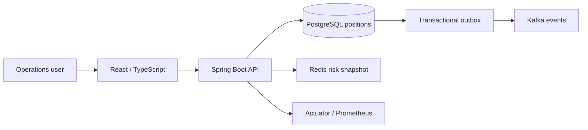

# Securities Position and Risk Platform

[](https://github.com/pthanureddy/securities-position-risk-platform/actions/workflows/ci.yml)
[](https://github.com/pthanureddy/securities-position-risk-platform/actions/workflows/pages.yml)

An independently built full-stack portfolio system for replay-safe synthetic
equity and futures execution intake, deterministic position aggregation, and
explicit notional-limit monitoring.

**[Open the synthetic-data browser demo](https://pthanureddy.github.io/securities-position-risk-platform/)**

This repository is not affiliated with Clear Street or another broker. It does
not use market, client, trading, or production data and is not suitable for
investment, execution, clearing, custody, or risk decisions.

## What it demonstrates

- Java 17 and Spring Boot REST APIs with validation, JPA, PostgreSQL, and
  Prometheus metrics.
- React and TypeScript operations dashboard for equity and futures positions.
- Idempotent execution intake that prevents a replay from applying the same
  position delta twice.
- Pessimistic position locking and optimistic entity versioning for consistent
  account/instrument updates.
- Transactional outbox, bounded Kafka publication, retry accounting, and failed
  event visibility.
- Redis adapter for short-lived derived risk summaries with graceful degradation.
- Versioned Protobuf event-contract design; the runnable Kafka adapter currently
  publishes JSON and does not claim Protobuf serialization.
- Docker Compose, Kubernetes probes/autoscaling, and an AWS Terraform blueprint
  for EKS, RDS PostgreSQL, MSK Serverless, and ElastiCache.
- CI for tests, coverage gates, dependency audit, production builds,
  infrastructure validation, and container builds.

## Architecture



One database transaction stores the immutable execution, updates the locked
position, and creates the outbox event. Kafka availability is outside that
consistency boundary. See [architecture](docs/ARCHITECTURE.md),
[requirements](docs/REQUIREMENTS.md), [operations](docs/OPERATIONS.md), and the
[performance and resilience strategy](docs/PERFORMANCE.md).

## Quality evidence

| Area | Verified result |
| --- | --- |
| Java backend | 21 tests; 88.08% line coverage; 100% branch coverage |
| React/TypeScript web | 18 tests; 80.30% line coverage; 72.22% branch coverage |
| Frontend production bundle | 198.90 kB JavaScript raw / 62.62 kB gzip |
| Dependency audit | 0 known vulnerabilities at build time |
| Delivery | Maven, ESLint, TypeScript, Vitest, Terraform, Compose, Docker, Pages CI |

The figures above are generated by the repository's verification commands. No
throughput number is claimed; the documented load-test design explains how a
defensible performance baseline should be produced.

## Run locally

### Browser-only demo

```bash
cd web
npm ci
npm run dev
```

Open `http://localhost:5173/?demo=true`.

### Java API without external services

The default profile uses H2 and disables Kafka and Redis adapters:

```bash
mvn --batch-mode -pl backend -am spring-boot:run
```

Open `http://localhost:8080/actuator/health`.

### Packaged stack

Docker Compose starts PostgreSQL, Redis, Kafka, the Java API, and the web:

```bash
docker compose up --build
```

Open `http://localhost:8088`. The committed database password is local-only and
must never be reused.

## API example

```bash
curl -i http://localhost:8080/api/v1/executions \
  -H "Content-Type: application/json" \
  -d '{
    "executionId": "EXEC-DEMO-001",
    "accountId": "NORTHSTAR-01",
    "instrument": "AAPL",
    "assetClass": "EQUITY",
    "side": "BUY",
    "quantity": 100,
    "price": 214.50,
    "currency": "USD",
    "executedAt": "2026-07-23T10:00:00Z"
  }'
```

Replay the same request: the response sets `duplicate` to `true` and the
position quantity does not change.

## Verify

```bash
mvn --batch-mode verify
cd web
npm ci
npm audit --audit-level=high
npm run lint
npm run test:coverage
npm run build
```

CI additionally formats and validates Terraform, checks the Compose model, and
builds both production container images.

## Deployment boundaries

The Kubernetes and Terraform assets are deployment blueprints only. They have
not been applied to a live AWS account. Before any real deployment, add
authentication and entitlements, reviewed database migrations, encrypted secret
delivery, network egress controls, audit retention, reconciliation, and
domain-complete securities accounting.

