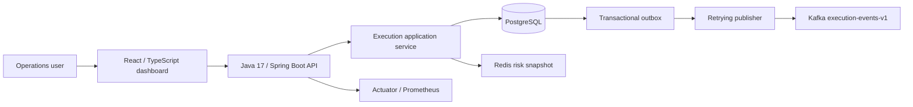

# Architecture

## Scope

This is an independent portfolio system for synthetic equity and futures
executions. It demonstrates engineering patterns; it is not a broker, matching
engine, general ledger, valuation service, or source of investment decisions.

## Runtime view

The browser demo is a deliberately self-contained TypeScript model backed by
synthetic data. The packaged stack sends API calls to the Java service.

## Consistency boundaries

One database transaction:

1. Rejects a malformed request at the HTTP boundary.
2. Checks the immutable execution ID.
3. Locks an existing account/instrument position for update.
4. Stores the execution.
5. Calculates and stores the position and limit state.
6. Stores an `ExecutionAccepted.v1` outbox event.

The unique execution ID makes retries replay-safe. A pessimistic database lock
serializes concurrent changes to one position, while the entity version remains
visible for conflict diagnosis. The outbox prevents a committed position change
from being lost merely because Kafka is temporarily unavailable.

## Messaging and cache boundaries

The publisher retrieves at most 50 pending events, waits for the Kafka broker
acknowledgement, and marks the event published in the surrounding database
transaction. Failures increment an attempt count; the fifth failure moves an
event to `FAILED` for operator action.

Redis contains only a five-minute derived risk summary. Cache serialization or
availability failures are logged but do not reject an otherwise valid execution.
PostgreSQL remains authoritative.

The JSON message is used by the runnable adapter. A versioned Protobuf schema is
included under `contracts/` to demonstrate an explicit evolution path. The
current runtime does not claim Protobuf serialization.

## Deliberate limitations

- Prices arrive with executions; there is no independent market-data service.
- Futures multipliers, FX conversion, P&L, margin, corporate actions, and
  settlement are outside scope.
- The local limit is one configurable absolute notional threshold, not a
  complete pre- or post-trade risk framework.
- Authentication, authorization, and entitlements would be mandatory before
  any non-portfolio deployment.
- The AWS Terraform is a reviewed deployment blueprint, not evidence of a live
  AWS environment.

